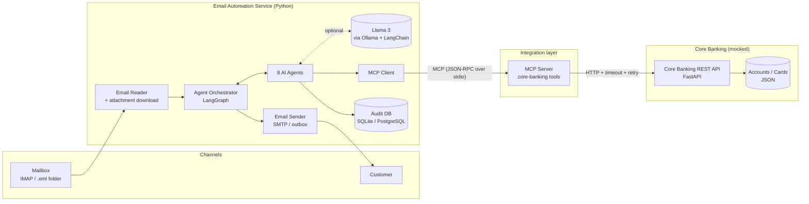
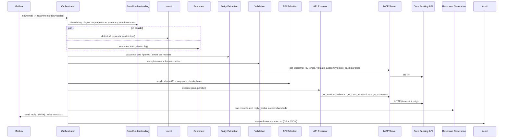

# 1. Solution Architecture

## 1.1 Purpose
Automate the handling of customer emails at a financial institution: understand the email (and its
attachments), detect every request and the customer's sentiment, validate account/card details, fetch
data from core banking systems and send one professional, consolidated reply — with a full audit trail.

## 1.2 High-level architecture

| Layer | Component | Technology |
|---|---|---|
| Input | Email Reader | `imaplib` (IMAP over SSL) or `.eml` folder, `email` stdlib parser |
| Attachments | Downloader + extractor | `pypdf` (PDF text), `pytesseract` + Pillow (OCR for any image format) |
| Intelligence | 8 agents | Python, Lingua language detection, Llama 3 (Ollama) via LangChain, rule-based NLP fallback |
| Orchestration | Agent Orchestrator | **LangGraph** state machine with parallel branches |
| Integration | MCP server/client | **Model Context Protocol** Python SDK (`mcp`) |
| Core systems | Mock core banking API | **FastAPI** + Uvicorn |
| Output | Email Sender | `smtplib` (SMTP + STARTTLS) or `.eml`/`.txt` files in `outbox/` |
| Audit | Audit/Logging Agent | SQLAlchemy (SQLite default, PostgreSQL via `DATABASE_URL`), rotating log files |
| Deployment | Containers | Docker, docker-compose (app, core-api, ollama) |

## 1.3 Why MCP?
The agents never call the core banking REST API directly. They call **MCP tools**
(`validate_account`, `get_account_balance`, …) exposed by `mcp_server/banking_mcp_server.py`.

* **Decoupling** – replacing the mock with the real core banking adapter only changes the MCP server.
* **Standard tool interface** – the same tools can be used by any MCP-capable LLM client
  (e.g. Claude Desktop, an IDE, another agent framework) without code changes.
* **Central resilience** – timeouts, retries with exponential back-off and a uniform
  `{ok, data | error}` envelope are implemented once, in the server.

## 1.4 Processing flow (one email)

## 1.5 Non-functional requirements — how they are met

| Requirement | Implementation |
|---|---|
| **Scalability** | Async I/O end-to-end; emails processed concurrently (`MAX_PARALLEL_EMAILS`); independent API calls run in parallel (`asyncio.gather`); stateless workers behind one MCP session; horizontally scalable containers. |
| **Security** | Account/card numbers masked (last 4 digits) in replies, logs, audit DB and summaries (`utils/masking.py` + logging filter); ownership check — data is only returned if the account/card belongs to the sender's registered profile; the LLM never produces facts; no secrets in code (`.env`). |
| **Auditability** | Every agent decision and every MCP tool call is stored in `audit_log` (run id, agent, event, masked payload, timestamp) + one JSON execution record per email in `logs/runs/`. |
| **Extensibility** | New intent = keyword rule + prompt line + one entry in `INTENT_TO_TOOL` + one MCP tool. Agents are independent classes; the graph is declared in one file. |
| **Accuracy** | Hybrid NLP: Llama 3 when available, deterministic rules otherwise; LLM output is schema-validated and **numbers are verified to exist in the source text** (anti-hallucination); confidence score per request; 23 automated tests. |
| **Performance** | Rule path processes an email in ~0.3–2 s (incl. API calls); per-call timeouts (5 s) and bounded retries keep the SLA predictable; one slow API never blocks the others. |

## 1.6 Deployment views
* **Developer laptop (default):** `python main.py` — starts the mock core API automatically, launches the MCP
  server as a subprocess, uses Llama 3 if Ollama runs locally.
* **Containers:** `docker compose up` — `core-api`, `ollama` (Llama 3) and `app` (orchestrator REST API).
* **Production (target):** app replicas behind a queue (e.g. one message per email), MCP server next to the
  real core-banking adapter, PostgreSQL for audit, IMAP/Graph API connector, secrets in a vault.
