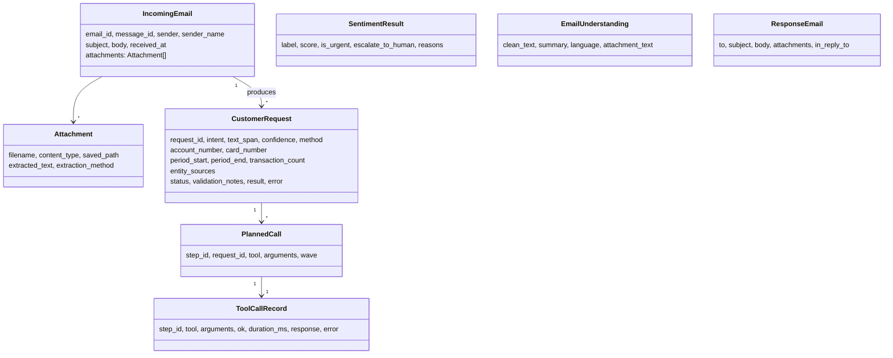
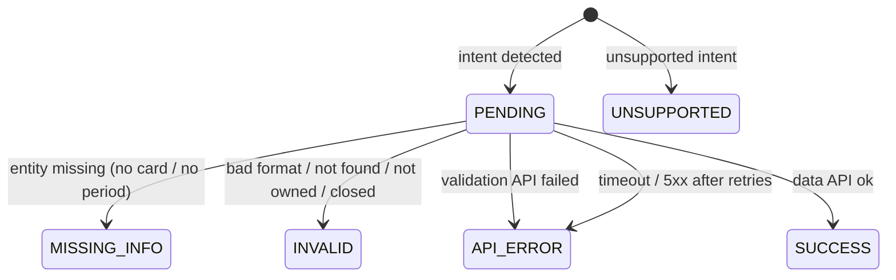
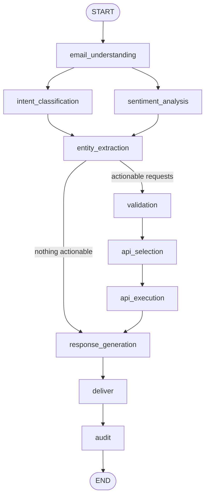

# 2. Low-Level Design

## 2.1 Folder structure

```
intelligent-email-automation-mcp/
├── agents/                       # one class per agent (section 7 of the task)
│   ├── email_understanding_agent.py   Email Understanding Agent
│   ├── intent_agent.py                Intent Classification Agent
│   ├── sentiment_agent.py             Sentiment Analysis Agent
│   ├── entity_agent.py                Entity Extraction Agent
│   ├── validation_agent.py            Validation Agent
│   ├── api_selection_agent.py         API Selection Agent (API Decision Engine)
│   ├── api_executor.py                executes the plan (parallel MCP calls)
│   ├── response_agent.py              Response Generation Agent
│   └── audit_agent.py                 Audit / Logging Agent
├── apis/
│   ├── core_banking_api.py        FastAPI mock core banking (5 APIs + customer lookup)
│   ├── core_banking_service.py    business logic + statement PDF generation
│   ├── orchestrator_api.py        REST API in front of the workflow
│   └── data/core_banking_data.json
├── mcp_server/banking_mcp_server.py   MCP server: core banking APIs as tools
├── models/schemas.py              Pydantic models (email, request, plan, result …)
├── prompts/*.txt                  Llama 3 prompts (one per LLM-backed agent)
├── workflows/
│   ├── state.py                   LangGraph state definition
│   └── email_workflow.py          Agent Orchestrator (graph) + batch processing
├── utils/
│   ├── email_io.py                IMAP/folder reader, attachment download, SMTP/outbox sender
│   ├── attachments.py             PDF text / OCR / text extraction
│   ├── nlp_rules.py               rule-based NLP (intents, entities, dates, sentiment)
│   ├── llm.py                     Ollama/Llama 3 via LangChain, JSON prompting
│   ├── mcp_client.py              MCP client (stdio) used by agents
│   ├── masking.py                 masking + logging filter
│   ├── audit_db.py                SQLAlchemy audit table
│   ├── logger.py                  logging framework
│   ├── core_api_runner.py         auto-start of the mock core API
│   └── text_utils.py              cleaning, Lingua language detection, INR formatting
├── config/settings.py, config/.env.example
├── tests/                         unit + end-to-end + LLM-path tests (pytest)
├── sample_emails/inbox/*.eml      12 sample test emails (incl. PDF & image attachments)
├── scripts/generate_sample_emails.py
├── docs/                          this documentation
├── logs/                          app.log, core_api.log, audit.db, runs/*.json
├── outbox/                        generated replies, statements, downloaded attachments
├── main.py, run_demo.sh, Dockerfile, docker-compose.yml, requirements.txt, README.md
```

## 2.2 Core data model (`models/schemas.py`)



**Request lifecycle (`RequestStatus`)**



## 2.3 Agents — inputs, logic, outputs

| Agent | Reads | Logic | Writes |
|---|---|---|---|
| Email Understanding | `email` | strip quoted replies & signatures; detect the cleaned email body's language with Lingua (ISO 639-1 code when available, otherwise `unknown`); concatenate extracted attachment text; produce a masked 1-line summary | `understanding` |
| Intent Classification | `understanding` | LLM splits into requests (validated: allowed intent, span must exist) **or** rules: sentence → clause split on *and/also/;*, keyword classification, orphan clauses merged as context, repeated intents merged; if the body has no request, the attachment text is classified | `requests[]` |
| Sentiment Analysis | `understanding` | LLM label **or** lexicon (negative, escalation, urgency, positive) with score; escalation flag never removed by the LLM | `sentiment` |
| Entity Extraction | `requests`, `understanding` | numbers classified by pattern + nearest keyword (*account*/*card*); masked cards `4567XXXX8901`; counts (`last 5`, `three`); periods (month names, ranges, DD/MM/YYYY, *last month*, *last N months*); look-up order clause → body (if unambiguous) → attachment; one request per number; LLM numbers verified against source text | `requests[]` (enriched), `customer_profile.name_in_email` |
| Validation | `requests`, sender | MCP `get_customer_by_email`; fill account from profile; MISSING_INFO checks; format checks; distinct numbers validated in **parallel** via MCP; ownership check | `requests[]`, `customer_profile`, `tool_calls` |
| API Selection | `requests` | `INTENT_TO_TOOL` mapping, build arguments, de-duplicate identical calls, wave assignment (all data calls independent → wave 1, parallel) | `plan[]` |
| API Executor | `plan` | `asyncio.gather` per wave; maps results/errors back to each request (partial success) | `requests[]`, `tool_calls` |
| Response Generation | everything | template sections per status (balance / transactions table / statement + PDF / invalid / clarification / API error / forwarded); LLM may only write the opening sentence (rejected if it contains digits); escalation note; security footer | `response` |
| Email Sender | `response` | `.eml` + `.txt` into `outbox/`, SMTP when `SEND_MODE=smtp` | `output_files` |
| Audit / Logging | full state | masked JSON record per email, `RUN_COMPLETED` event | `logs/runs/<id>.json` |

## 2.4 Orchestration graph (`workflows/email_workflow.py`)


`trace`, `tool_calls` and `llm_agents` use LangGraph reducers (`operator.add`) so parallel branches can
append without overwriting each other.

## 2.5 Error handling matrix

| Situation | Where | Behaviour |
|---|---|---|
| Invalid account/card (not found, closed, blocked, wrong format) | Validation Agent / core API | request → `INVALID`; reply asks the customer to recheck that number; other requests still answered |
| Account/card of another customer | Validation Agent | treated as invalid (no data leakage) |
| Missing account | Validation Agent | primary account from the sender's profile; else `MISSING_INFO` |
| Missing card number / statement period | Validation Agent | `MISSING_INFO` → clarification request in the reply |
| Core API timeout (> 5 s) | MCP server | `TIMEOUT` envelope → `API_ERROR`, reference number in the reply |
| Core API 502/503/504 / connection error | MCP server | retried (exponential back-off, `CORE_API_MAX_RETRIES`), then `SERVICE_UNAVAILABLE` |
| MCP transport failure | MCP client | `MCP_ERROR` envelope, never raises |
| Unsupported request (cheque book, loan, …) | Intent Agent | `UNSUPPORTED` → "forwarded to customer support" |
| LLM down / invalid JSON / hallucinated values | `utils/llm.py`, agents | automatic fallback to rules per call; numbers not present in the email are discarded |
| Unreadable attachment / no OCR engine | `utils/attachments.py` | logged, email processed with the remaining information |
| Unexpected exception in one email | `process_batch` | logged; other emails continue |

## 2.6 Configuration
All settings live in `config/settings.py` (pydantic-settings) and can be overridden by environment
variables or `.env` — LLM provider/model, core API host/port/timeout/retries/chaos failure rate,
IMAP/SMTP, folders, concurrency, database URL. See `config/.env.example`.
